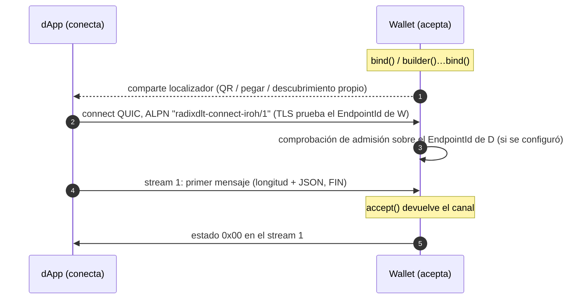
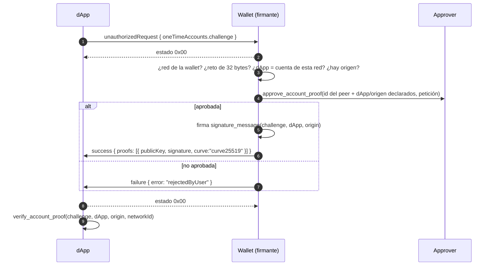
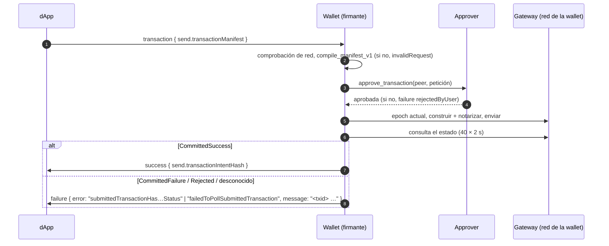
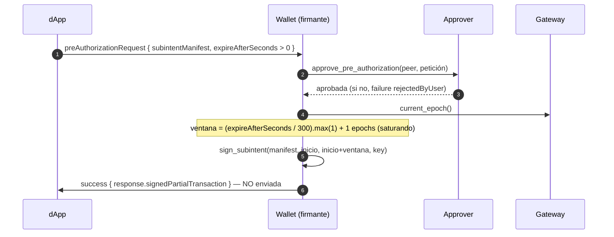

# radixdlt-connect-iroh — Especificación del protocolo de transporte

*[English](PROTOCOL.md) · **Español***

Versión: `radixdlt-connect-iroh/1` · Estado: refleja el código de
`crates/connect-iroh` (`src/lib.rs`, `src/channel.rs`, `src/protocol.rs`) y el esquema
compartido de interacción con la wallet en `crates/connect-types`.

Este documento especifica cómo dos peers Rust del SDK intercambian mensajes de
interacción de wallet Radix sobre el transporte [iroh](https://iroh.computer)
(QUIC). Es el protocolo propio del SDK: la wallet móvil de Radix no lo habla (habla
*Radix Connect over iroh v1*, el módulo `mobile`). Ambos extremos ejecutan el SDK
—p. ej. un firmante de escritorio, un servidor o un dispositivo— de modo que flujos
como ROLA "iniciar sesión con Radix" se ejecutan enteramente en Rust, sin teléfono.

La versión 0 (un único stream bidireccional para toda la conexión, frames con prefijo
de longitud, sin confirmaciones) ya no se habla. Su ALPN es otro, así que un peer v0 y
uno v1 fallan en el handshake QUIC en lugar de malinterpretarse.

---

## 1. Roles

| Rol | API | Comportamiento |
| --- | --- | --- |
| **dApp** | `IrohConnector::connect*` + `protocol::request_*` | Marca, **envía la petición primero** y luego lee y (para ROLA) verifica de forma nativa la respuesta. |
| **Wallet** (firmante) | `IrohConnector::accept` + `protocol::Wallet::answer` | Acepta, **recibe la petición primero**, pregunta a su `Approver` y responde. |

En la capa de transporte ambos extremos son simétricos: un `IrohChannel` envía y recibe
en cualquier dirección, cualquier número de mensajes. Quién habla primero es el
contrato de la aplicación; `IrohConnector::accept` (y `Pending::ready`) vuelve cuando el
peer ha empezado su primer mensaje.

---

## 2. Capa de transporte

- **Sustrato:** endpoints iroh 1.x sobre QUIC (TLS 1.3). Un endpoint se identifica por su
  `EndpointId`, una clave pública Ed25519; el handshake prueba que el peer tiene su clave.
- **ALPN:** `radixdlt-connect-iroh/1` (`ALPN`, `src/lib.rs`). No se acepta ningún otro.
- **Streams:** cada mensaje viaja en un **stream QUIC bidireccional propio**, que abre
  quien lo envía. Un peer puede tener como mucho 8 streams abiertos hacia un endpoint a
  la vez (los mensajes son secuenciales; el resto es margen para envíos abandonados), y
  ningún stream unidireccional: eso acota lo que un peer puede hacer que un endpoint
  guarde en memoria.

### 2.1 Un mensaje

```
emisor                                              receptor
  │ open_bi                                            │
  │ ── longitud (u32, big-endian) ───────────────────▶ │  rechazado al momento si longitud > su límite
  │ ── cuerpo JSON (`longitud` bytes, UTF-8) ────────▶ │
  │ ── FIN ──────────────────────────────────────────▶ │  exactamente `longitud` bytes, y el final
  │ ◀────────────────────────── estado (1 byte) ────── │
  │ ◀────────────────────────────────────────── FIN ── │
```

| Estado | Significado | `send_message` del emisor |
| --- | --- | --- |
| `0x00` | recibido: la aplicación del receptor tiene el mensaje | `Ok(())` |
| `0x01` | supera el límite de tamaño del receptor; no se leyó | `Err(Refused { too_large: true })` |
| `0x02` | no es un documento JSON de la longitud anunciada | `Err(Refused { too_large: false })` |

- El receptor lee la longitud, la compara con su límite **antes de reservar nada**, y su
  búfer crece solo a medida que llegan bytes. Si la supera, envía `STOP_SENDING`
  (código 1) y el estado `0x01`.
- Más bytes de los anunciados (stream detenido con código 3), o bytes que no son JSON, se
  responden con `0x02`.
- Un stream que termina (FIN) antes de `longitud` bytes, o que se resetea, no lleva
  mensaje: el receptor lo salta y lee el siguiente stream.

### 2.2 Límites

`Limits` (por endpoint, `Builder::limits`):

| Límite | Por defecto | Se aplica a |
| --- | --- | --- |
| `max_message_size` | 8 MiB | Cuerpo JSON, enviado o recibido (como mucho `u32::MAX`). |
| `message_timeout` | 60 s | Recepción: aceptado el stream del peer, el mensaje entero debe llegar. Envío: abrir, escribir y el byte de estado. |
| `close_timeout` | 5 s | `IrohChannel::close`, `IrohChannel::wait_closed`, `IrohConnector::close`. |

Esperar a que el peer **empiece** su siguiente mensaje no está acotado: un canal puede
quedarse abierto e inactivo tanto tiempo como ambos extremos quieran.

### 2.3 Cancelación

Ambas operaciones son seguras ante cancelación (se pueden envolver en
`tokio::time::timeout` o `select!`):

- **Envío.** El stream de envío está protegido: si la operación se suelta antes de
  escribir el mensaje entero y terminar el stream, el stream se **resetea** (código 2),
  nunca se termina, así que el receptor no puede tomar un mensaje truncado por uno
  entero. Soltada después de ese punto, el mensaje está entero y el receptor aún puede
  tomarlo.
- **Recepción.** El mensaje recibido a medias (su stream y los bytes hasta el momento) se
  guarda en el canal; el siguiente `recv_message` lo reanuda.

Como cada mensaje tiene su propio stream y su propio prefijo de longitud, nada de lo que
deja una operación interrumpida puede leerse como el comienzo de otro mensaje.

### 2.4 Ciclo de vida de la conexión

1. La dApp resuelve la dirección de la Wallet (§3) y marca con el ALPN. El handshake
   autentica el `EndpointId` de la Wallet. Si la Wallet solo admite algunos peers (§3.3),
   cierra cualquier otra conexión justo después del handshake (código de cierre 1, motivo
   `not admitted`).
2. Se intercambian mensajes según el flujo de la interacción (§5), cada uno confirmado
   (§2.1).
3. Cualquiera de los lados llama a `IrohChannel::close`: espera (acotado) a que su última
   confirmación haya sido reconocida y cierra la conexión (código 0, motivo `done`).
   Soltar un canal hace lo mismo en segundo plano. `IrohConnector::close` cierra el
   endpoint y todas sus conexiones (acotado).

---

## 3. Emparejamiento, descubrimiento y admisión

| Localizador | Producido por | Contenido | Uso |
| --- | --- | --- | --- |
| **ticket** | `ticket()` | hex(JSON de `EndpointAddr`): el id, todas las direcciones que iroh conoce del endpoint (las de interfaz/LAN; con `Relay::Enabled`, su relé y su dirección pública cuando se conozca) y loopback | Mismo host o LAN (pegar o QR); internet con `Relay::Enabled` en ambos extremos. Se consume con `connect_to_ticket`. |
| **id_ticket** | `id_ticket()` | hex(JSON de `EndpointAddr`), **solo** el id | Peers con `Relay::Enabled`, que buscan el id. Se consume con `connect_to_ticket`. |
| **endpoint id** | `endpoint_id_string()` / `endpoint_id_from_seed(seed)` | la cadena del `EndpointId` | Como id_ticket. Se consume con `connect_to_endpoint_id`. |

Este crate no tiene mDNS. Una aplicación que quiera descubrimiento en la LAN anuncia un
ticket por su cuenta.

### 3.1 Identidad

- **Efímera** (`bind()` / `bind_with(None, …)`): una clave aleatoria nueva en cada ejecución.
- **Fija** (`Builder::secret(seed)` / `bind_with(Some(seed), …)`): una semilla de 32 bytes →
  un `EndpointId` y un `id_ticket` estables entre reinicios; `endpoint_id_from_seed` lo
  deriva sin red.

Usa una semilla dedicada al endpoint, no la clave de una cuenta de Radix: el `EndpointId`
es público (lo ven los peers y los relés; con `Relay::Enabled` se publica junto a la URL
del relé del endpoint), así que una clave de cuenta ataría esa cuenta a la presencia en
red de la máquina, y una misma clave firmaría en dos protocolos (handshakes TLS y
transacciones de Radix). Un servidor cuya identidad es pública por diseño puede elegir
otra cosa —PamAuthority hace que el `EndpointId` de su hub sea la clave que firma las
listas que envía a sus máquinas— conociendo ese compromiso.

### 3.2 Relé / alcance

| Modo | Significado |
| --- | --- |
| `Relay::Disabled` | Solo conexiones directas (mismo host / LAN): preset `Minimal`, sin relé, sin búsqueda de direcciones, sin mapeo de puertos. |
| `Relay::Enabled` | Preset `N0`: relés públicos de n0 y búsqueda de direcciones por el pkarr/DNS de n0 (el endpoint publica la URL de su relé bajo su id). El mapeo de puertos (UPnP / NAT-PMP / PCP) puede pedir al router local que abra un puerto para conexiones directas. Los relés reenvían paquetes cifrados de extremo a extremo. |

### 3.3 Admisión

Por defecto cualquier peer puede conectarse. `Builder::allow_only(ids)` o
`Builder::admit(fn)` restringen quién puede conectarse **a** un endpoint: la comprobación
se hace justo después del handshake, sobre el `EndpointId` autenticado, antes de que la
aplicación vea la conexión (`Pending::ready` devuelve un error). Marcar hacia fuera no se
restringe. Cada canal expone a su peer como `IrohChannel::remote_id()`.

---

## 4. Formato de mensaje (capa de aplicación)

Las cargas JSON son el **mismo esquema de interacción de wallet** que usa el transporte
WebRTC, construido por `radixdlt-connect-types`.

### 4.1 Envoltura de petición

```json
{
  "interactionId": "<uuid-v4>",
  "metadata": {
    "version": 2,
    "networkId": <u8>,
    "dAppDefinitionAddress": "<account_...>",
    "origin": "<cadena de origen>"
  },
  "items": { "discriminator": "<tipo>", ... }
}
```

| `items.discriminator` | Interacción |
| --- | --- |
| `unauthorizedRequest` / `authorizedRequest` | Prueba de cuenta (ROLA) |
| `transaction` | Firmar + enviar un manifiesto de transacción |
| `preAuthorizationRequest` | Firmar un subintent (pre-autorización) |

### 4.2 Envoltura de respuesta

```json
{ "discriminator": "success", "interactionId": "<eco>", "items": { ... } }
{ "discriminator": "failure", "interactionId": "<eco>", "error": "<código>", "message": "<por qué>" }
```

En el lado dApp un `failure` se convierte en `IrohError::Rejected("<código>: <por qué>")`.

| `error` | Cuándo |
| --- | --- |
| `wrongNetwork` | `metadata.networkId` no es la red de la Wallet. |
| `invalidRequest` | Petición malformada; reto ROLA que no es de 32 bytes (hex); definición de dApp que no es una cuenta de la red de la Wallet; origen vacío; manifiesto que no compila; pre-autorización sin caducidad; interacción no soportada. |
| `rejectedByUser` | El `Approver` no la aprobó. |
| `failedToPrepareTransaction` / `failedToSignTransaction` | Falló el Gateway (epoch) o la firma. |
| `failedToSubmitTransaction` | El Gateway no aceptó el envío. |
| `submittedTransactionHasFailedTransactionStatus` | Enviada y confirmada **como fallida**. |
| `submittedTransactionHasRejectedTransactionStatus` | Enviada y rechazada. |
| `failedToPollSubmittedTransaction` | Enviada, resultado aún desconocido (aún puede confirmarse): comprueba el hash del intent antes de reintentar. |

El `message` de un fallo de transacción nombra el hash del intent.

---

## 5. Flujos de interacción

### 5.1 Establecimiento de la conexión



### 5.2 Prueba de cuenta — ROLA "iniciar sesión con Radix"



### 5.3 Transacción — firmar y enviar



### 5.4 Pre-autorización — firmar un subintent (sin enviar)



---

## 6. Modelo de errores

`IrohError` (`#[non_exhaustive]`, localizado al idioma del sistema en `Display`):

| Variante | Se lanza cuando |
| --- | --- |
| `Bind` | No se pudo enlazar el endpoint local. |
| `Connect` | No se pudo alcanzar/marcar al peer (inalcanzable, otra versión del protocolo, no admitido), o ticket/endpoint id inválido. |
| `Accept` | Falló la aceptación: endpoint cerrado, handshake fallido, peer no admitido. |
| `Stream` | La conexión se cerró o se perdió. |
| `Protocol` | Falló la (de)serialización, un mensaje rompió el encuadre, o error a nivel de interacción (falló la verificación ROLA, respuesta malformada). |
| `Rejected` | La Wallet respondió `failure` (§4.2). |
| `TooLarge { size, max }` | Un mensaje que supera el límite de este lado: no se envió, o se rechazó por su prefijo de longitud. |
| `Refused { too_large }` | El peer rechazó nuestro mensaje (estado `0x01` / `0x02`). |
| `Timeout { sending, after }` | Un mensaje empezado no llegó entero, o el nuestro no se confirmó (el peer aún podría tomarlo), en `message_timeout`. |

Tras `TooLarge`, `Refused`, `Timeout` o un error `Protocol` sobre un mensaje, el canal
sigue usable.

---

## 7. Notas de seguridad

- **Confidencialidad/integridad del canal e identidad del peer:** QUIC/TLS 1.3. Marcar un
  `EndpointId` llega a quien tiene esa clave o falla; `remote_id()` nombra al peer en
  ambos lados.
- **Quién puede conectarse:** cualquiera, salvo que `allow_only` / `admit` digan otra
  cosa (§3.3). Las aplicaciones que autentican a sus peers por su cuenta pueden mantener
  el valor por defecto.
- **Recursos acotados:** el tamaño de mensaje, el tiempo para completar un mensaje
  empezado, los streams por conexión y el cierre están acotados (§2.2). Cuántas
  conexiones acepta un endpoint lo acota la aplicación (p. ej. en su bucle de accept).
- **Una Wallet solo firma lo que aprueba su `Approver`.** Por defecto no se firma nada
  (`DenyAll`, y cada método de `Approver` rechaza salvo que se implemente). La definición
  de dApp y el origen que lleva una petición son declaraciones; solo el `EndpointId` del
  peer está autenticado. Nunca expongas una Wallet a peers desconocidos con un aprobador
  permisivo.
- **ROLA:** la propiedad de la cuenta se prueba y se **verifica de forma nativa** en la
  dApp contra el reto, la definición de dApp, el origen y el network id —
  independientemente del transporte.
- **Confianza en el relé:** con `Relay::Enabled`, los relés ven los dos `EndpointId` y el
  momento y tamaño de los paquetes cifrados, nunca su contenido; la búsqueda de
  direcciones de n0 publica la URL del relé del endpoint bajo su id.
