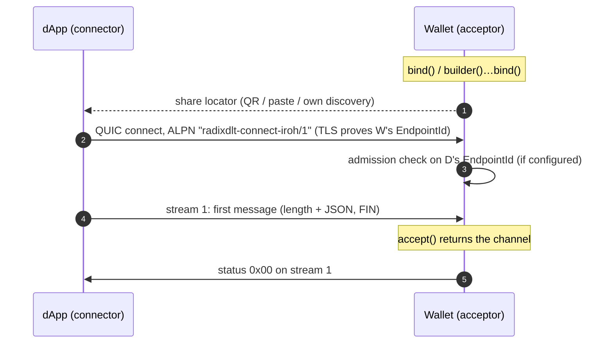
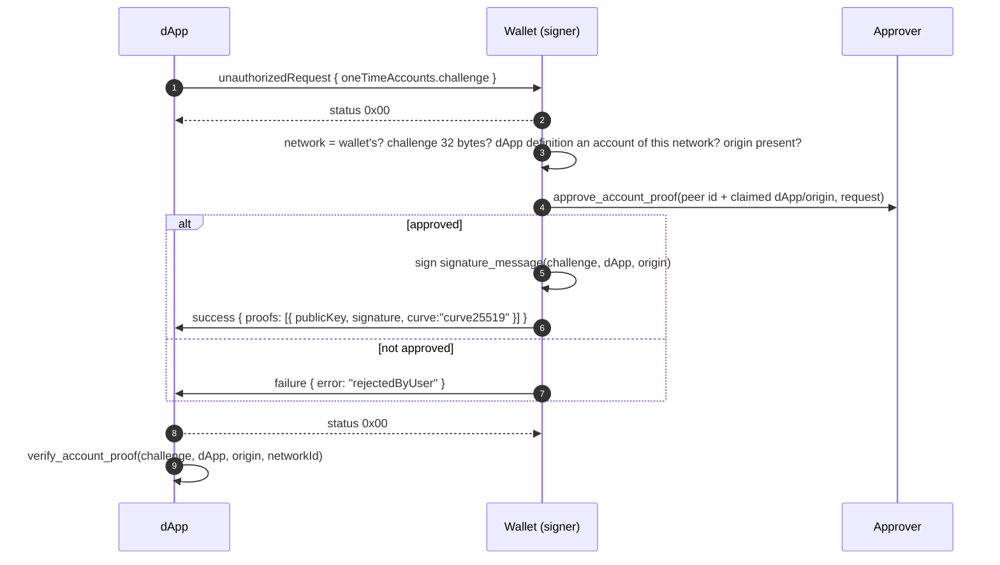
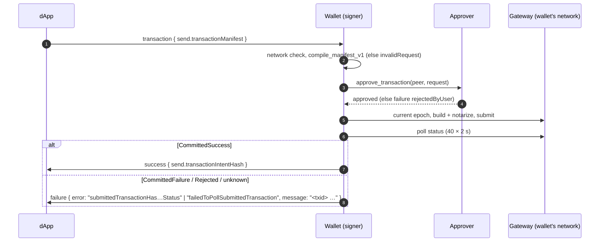
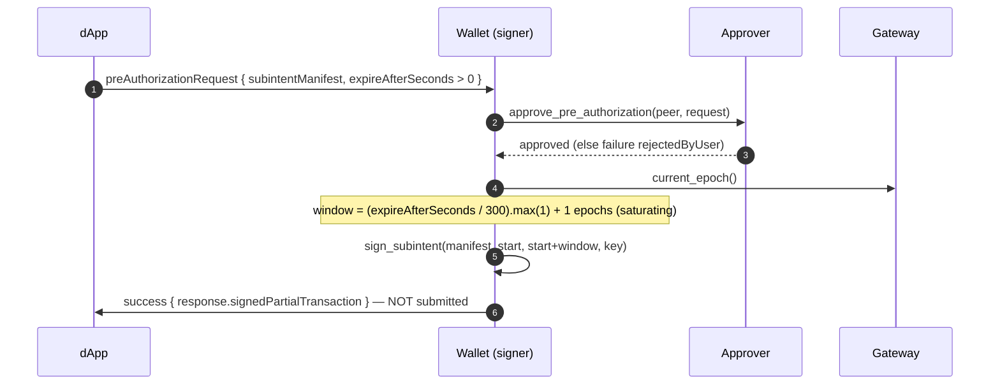

# radixdlt-connect-iroh — Transport Protocol Specification

***English** · [Español](PROTOCOL.es.md)*

Version: `radixdlt-connect-iroh/1` · Status: reflects the code in
`crates/connect-iroh` (`src/lib.rs`, `src/channel.rs`, `src/protocol.rs`) and the shared
wallet-interaction schema in `crates/connect-types`.

This document specifies how two pure-Rust SDK peers exchange Radix
wallet-interaction messages over the [iroh](https://iroh.computer) (QUIC)
transport. It is the SDK's own protocol: the Radix mobile wallet does not speak it
(it speaks *Radix Connect over iroh v1*, the `mobile` module). Both endpoints run the
SDK — e.g. a desktop signer, a server, or a device — so flows such as ROLA "log in
with Radix" run entirely in Rust with no phone involved.

Version 0 (one bidirectional stream for the whole connection, length-prefixed
frames, no confirmations) is not spoken any more. Its ALPN differs, so a v0 peer and
a v1 peer fail at the QUIC handshake instead of misreading each other.

---

## 1. Roles

| Role | API | Behaviour |
| --- | --- | --- |
| **dApp** | `IrohConnector::connect*` + `protocol::request_*` | Dials, **sends the request first**, then reads and (for ROLA) natively verifies the response. |
| **Wallet** (signer) | `IrohConnector::accept` + `protocol::Wallet::answer` | Accepts, **receives the request first**, asks its `Approver`, and answers. |

At the transport level both ends are symmetric: an `IrohChannel` sends and receives in
either direction, any number of messages. Which side speaks first is the application's
contract; `IrohConnector::accept` (and `Pending::ready`) returns once the peer has
started its first message.

---

## 2. Transport layer

- **Substrate:** iroh 1.x endpoints over QUIC (TLS 1.3). An endpoint is identified by its
  `EndpointId`, an Ed25519 public key; the handshake proves the peer holds its key.
- **ALPN:** `radixdlt-connect-iroh/1` (`ALPN`, `src/lib.rs`). Nothing else is accepted.
- **Streams:** every message travels on a **bidirectional QUIC stream of its own**, opened
  by its sender. A peer may have at most 8 streams open towards an endpoint at once
  (messages are sequential; the rest is headroom for abandoned sends), and no
  unidirectional streams: this bounds what one peer can make an endpoint buffer.

### 2.1 One message

```
sender                                              receiver
  │ open_bi                                            │
  │ ── length (u32, big-endian) ─────────────────────▶ │  refused at once if length > its limit
  │ ── JSON body (`length` bytes, UTF-8) ────────────▶ │
  │ ── FIN ──────────────────────────────────────────▶ │  exactly `length` bytes, then the end
  │ ◀──────────────────────────── status (1 byte) ──── │
  │ ◀────────────────────────────────────────── FIN ── │
```

| Status | Meaning | Sender's `send_message` |
| --- | --- | --- |
| `0x00` | taken: the receiver's application has the message | `Ok(())` |
| `0x01` | over the receiver's size limit; not read | `Err(Refused { too_large: true })` |
| `0x02` | not one JSON document of the length announced | `Err(Refused { too_large: false })` |

- The receiver reads the length, compares it with its limit **before allocating
  anything**, and grows its buffer only as bytes arrive. Over the limit it sends
  `STOP_SENDING` (code 1) and status `0x01`.
- More bytes than announced (stream stopped with code 3), or bytes that are not JSON, are
  answered `0x02`.
- A stream that ends (FIN) before `length` bytes, or is reset, carries no message: the
  receiver skips it and reads the next stream.

### 2.2 Bounds

`Limits` (per endpoint, `Builder::limits`):

| Bound | Default | Applies to |
| --- | --- | --- |
| `max_message_size` | 8 MiB | JSON body, sent or received (at most `u32::MAX`). |
| `message_timeout` | 60 s | Receiving: once the peer's stream is accepted, the whole message must arrive. Sending: open, write, and the status byte. |
| `close_timeout` | 5 s | `IrohChannel::close`, `IrohChannel::wait_closed`, `IrohConnector::close`. |

Waiting for the peer to **start** its next message is not bounded: a channel may stay
open and idle for as long as both ends want.

### 2.3 Cancellation

Both operations are cancel-safe (they can be wrapped in `tokio::time::timeout` or
`select!`):

- **Sending.** The send stream is guarded: if the operation is dropped before the whole
  message is written and the stream finished, the stream is **reset** (code 2), never
  finished, so the receiver cannot take a truncated message for a whole one. Dropped
  after that point, the message is whole and the receiver may still take it.
- **Receiving.** The partly received message (its stream and the bytes so far) is kept
  in the channel; the next `recv_message` resumes it.

Because each message has its own stream and its own length prefix, nothing an
interrupted operation leaves behind can be read as the start of another message.

### 2.4 Connection lifecycle

1. The dApp resolves the Wallet's address (§3) and dials with the ALPN. The handshake
   authenticates the Wallet's `EndpointId`. If the Wallet admits only some peers (§3.3),
   it closes any other connection right after the handshake (close code 1, reason
   `not admitted`).
2. Messages are exchanged per the interaction flow (§5), each confirmed (§2.1).
3. Either side calls `IrohChannel::close`: it waits (bounded) until its last
   confirmation has been acknowledged, then closes the connection (code 0, reason
   `done`). Dropping a channel does the same in the background. `IrohConnector::close`
   closes the endpoint and all its connections (bounded).

---

## 3. Pairing, discovery and admission

| Locator | Produced by | Contents | Use |
| --- | --- | --- | --- |
| **ticket** | `ticket()` | hex(JSON `EndpointAddr`): the id, every address iroh knows for the endpoint (interface/LAN addresses; with `Relay::Enabled`, its relay and public address once known) and loopback | Same host or LAN (paste or QR); internet with `Relay::Enabled` on both ends. Consumed by `connect_to_ticket`. |
| **id_ticket** | `id_ticket()` | hex(JSON `EndpointAddr`), id **only** | Peers with `Relay::Enabled`, which look the id up. Consumed by `connect_to_ticket`. |
| **endpoint id** | `endpoint_id_string()` / `endpoint_id_from_seed(seed)` | the `EndpointId` string | As id_ticket. Consumed by `connect_to_endpoint_id`. |

There is no mDNS in this crate. An application that wants LAN discovery advertises a
ticket itself.

### 3.1 Identity

- **Ephemeral** (`bind()` / `bind_with(None, …)`): a fresh random key each run.
- **Fixed** (`Builder::secret(seed)` / `bind_with(Some(seed), …)`): a 32-byte seed → a
  stable `EndpointId` and `id_ticket` across restarts; `endpoint_id_from_seed` derives it
  offline.

Use a seed dedicated to the endpoint, not a Radix account's key: the `EndpointId` is
public (peers and relays see it; with `Relay::Enabled` it is published with the
endpoint's relay URL), so an account key would link that account to the machine's
network presence, and one key would sign in two protocols (TLS handshakes and Radix
transactions). A server whose identity is public by design may choose otherwise —
PamAuthority makes its hub's `EndpointId` the key that signs the lists it sends to its
machines — knowing that trade-off.

### 3.2 Relay / reachability

| Mode | Meaning |
| --- | --- |
| `Relay::Disabled` | Direct connections only (same host / LAN): preset `Minimal`, no relay, no address lookup, no port mapping. |
| `Relay::Enabled` | Preset `N0`: n0 public relays, and address lookup through n0's pkarr/DNS (the endpoint publishes its relay URL under its id). Port mapping (UPnP / NAT-PMP / PCP) may ask the local router to open a port for direct connections. Relays forward end-to-end encrypted packets. |

### 3.3 Admission

By default any peer may connect. `Builder::allow_only(ids)` or `Builder::admit(fn)`
restrict who may connect **to** an endpoint: the check runs right after the handshake,
on the authenticated `EndpointId`, before the application sees the connection
(`Pending::ready` returns an error). Dialling out is not restricted. Every channel
exposes its peer as `IrohChannel::remote_id()`.

---

## 4. Message format (application layer)

The JSON payloads are the **same wallet-interaction schema** the WebRTC
transport uses, built by `radixdlt-connect-types`.

### 4.1 Request envelope

```json
{
  "interactionId": "<uuid-v4>",
  "metadata": {
    "version": 2,
    "networkId": <u8>,
    "dAppDefinitionAddress": "<account_...>",
    "origin": "<origin string>"
  },
  "items": { "discriminator": "<kind>", ... }
}
```

| `items.discriminator` | Interaction |
| --- | --- |
| `unauthorizedRequest` / `authorizedRequest` | Account proof (ROLA) |
| `transaction` | Sign + submit a transaction manifest |
| `preAuthorizationRequest` | Sign a subintent (pre-authorization) |

### 4.2 Response envelope

```json
{ "discriminator": "success", "interactionId": "<echoed>", "items": { ... } }
{ "discriminator": "failure", "interactionId": "<echoed>", "error": "<code>", "message": "<why>" }
```

On the dApp side a `failure` becomes `IrohError::Rejected("<code>: <why>")`.

| `error` | When |
| --- | --- |
| `wrongNetwork` | `metadata.networkId` is not the Wallet's network. |
| `invalidRequest` | Malformed request; ROLA challenge not 32 bytes (hex); dApp definition not an account of the Wallet's network; empty origin; manifest that does not compile; pre-authorization without expiry; unsupported interaction. |
| `rejectedByUser` | The `Approver` did not approve it. |
| `failedToPrepareTransaction` / `failedToSignTransaction` | The Gateway (epoch) or the signing failed. |
| `failedToSubmitTransaction` | The Gateway did not accept the submission. |
| `submittedTransactionHasFailedTransactionStatus` | Submitted and committed **as a failure**. |
| `submittedTransactionHasRejectedTransactionStatus` | Submitted and rejected. |
| `failedToPollSubmittedTransaction` | Submitted, outcome not known yet (it may still commit): check the intent hash before retrying. |

The `message` of a transaction failure names the intent hash.

---

## 5. Interaction flows

### 5.1 Connection establishment



### 5.2 Account proof — ROLA "log in with Radix"



### 5.3 Transaction — sign and submit



### 5.4 Pre-authorization — sign a subintent (no submit)



---

## 6. Error model

`IrohError` (`#[non_exhaustive]`, localized to the system language on `Display`):

| Variant | Raised when |
| --- | --- |
| `Bind` | The local endpoint could not bind. |
| `Connect` | Could not reach / dial the peer (unreachable, other protocol version, not admitted), or an invalid ticket/endpoint id. |
| `Accept` | Accepting failed: endpoint closed, handshake failed, peer not admitted. |
| `Stream` | The connection was closed or lost. |
| `Protocol` | (De)serialization failed, a message broke the framing, or an interaction-level error (ROLA verification failed, malformed response). |
| `Rejected` | The Wallet answered `failure` (§4.2). |
| `TooLarge { size, max }` | A message over this side's limit: not sent, or refused from its length prefix. |
| `Refused { too_large }` | The peer refused our message (status `0x01` / `0x02`). |
| `Timeout { sending, after }` | A started message did not arrive whole, or ours was not confirmed (the peer may still take it), within `message_timeout`. |

After `TooLarge`, `Refused`, `Timeout` or a `Protocol` error about one message, the
channel is still usable.

---

## 7. Security notes

- **Channel confidentiality/integrity and peer identity:** QUIC/TLS 1.3. Dialling an
  `EndpointId` reaches that key's holder or fails; `remote_id()` names the peer on both
  sides.
- **Who may connect:** anyone, unless `allow_only` / `admit` say otherwise (§3.3).
  Applications that authenticate peers themselves may keep the default.
- **Resource bounds:** message size, time to complete a started message, streams per
  connection, and close are all bounded (§2.2). The number of connections an endpoint
  accepts is the application's to bound (e.g. in its accept loop).
- **A Wallet signs only what its `Approver` approves.** Nothing signs by default
  (`DenyAll`, and every `Approver` method refuses unless implemented). The dApp
  definition and origin a request carries are claims; only the peer's `EndpointId` is
  authenticated. Never expose a Wallet to unknown peers with a permissive approver.
- **ROLA:** account ownership is proven and **verified natively** by the dApp against
  the challenge, dApp definition, origin and network id — independently of the
  transport.
- **Relay trust:** with `Relay::Enabled`, relays see the two `EndpointId`s and the timing
  and size of encrypted packets, never their contents; n0's address lookup publishes
  the endpoint's relay URL under its id.
